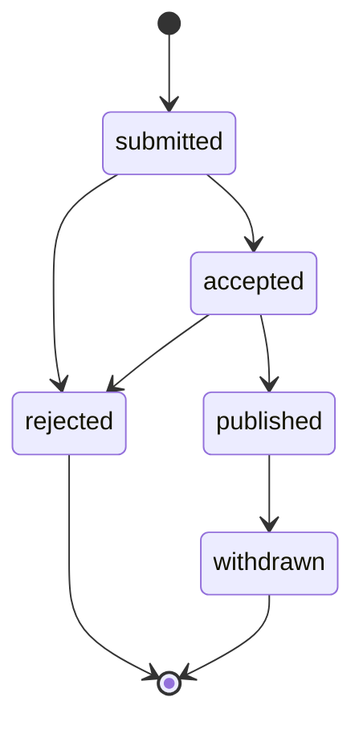

# Drafts in storage

In the draft pattern, each contribution waits as a draft in your
storage. An admin accepts it, rejects it, or publishes it in your app.
The module `enacit4r_contrib.drafts` gives this pattern. The intake,
the validator and `contribution_router` stay the same as for pull
requests. Only the sink and the decision step change.

## When to use drafts

Use drafts instead of pull requests in these conditions:

- A database or a search index holds the published copy, not a git
  repository.
- The reviewers work in an admin page of your app, not on GitHub.
- Your project has no GitHub App, or the data must not go to GitHub.

## The states

A draft starts in `submitted`. The constant `TRANSITIONS` holds the
allowed moves. Any other move raises `TransitionError`.



Each decision adds a `Decision` to the history of the draft: the new
state, the reviewer, the UTC time, and a comment. A rejection must have
a comment.

## The pieces

| Piece              | Task                                                        |
| ------------------ | ----------------------------------------------------------- |
| `FolderDraftStore` | Writes `<root>/<id>/files/` and `<root>/<id>/draft.json`    |
| `DraftSink`        | Saves each valid contribution as a draft in `submitted`     |
| `Review`           | Checks a move, calls your hooks, and records the decision   |
| `review_router`    | The admin endpoints under `/drafts`                         |

`open_count` counts the drafts in `submitted` or `accepted`. The
pipeline compares this number with `max_open`.

## Wire it

```python
from pathlib import Path

from fastapi import Header, HTTPException

from enacit4r_contrib import Pipeline, contribution_router
from enacit4r_contrib.drafts import DraftSink, FolderDraftStore, Review, review_router

store = FolderDraftStore(Path("/data/drafts"))
pipeline = Pipeline(validate, DraftSink(store))


def reviewer(x_user: str | None = Header(default=None)) -> str:
    # Placeholder: replace with your own auth (Keycloak, GitHub OAuth, a password).
    if x_user is None:
        raise HTTPException(401, "Log in")
    return x_user


async def on_publish(draft, files):
    await load_into_database(draft.id, files)  # your project's loader


app.include_router(contribution_router(pipeline, allow=["*.csv"]))
app.include_router(
    review_router(Review(store, on_publish=on_publish), reviewer=reviewer),
    prefix="/admin",
)
```

The `reviewer` dependency returns the name of the reviewer, or raises
401 or 403. The router uses it on each endpoint.

| Endpoint                            | Result                              |
| ----------------------------------- | ----------------------------------- |
| `GET /drafts?state=`                | The drafts, filtered by state       |
| `GET /drafts/{id}`                  | One draft                           |
| `GET /drafts/{id}/files/{path}`     | The bytes of one file               |
| `POST /drafts/{id}/decision`        | Body `{state, comment}`, a decision |

A decision answers 200 with the draft. A move that `TRANSITIONS` does
not allow answers 409. A rejection without a comment answers 422. An
unknown draft or file answers 404.

## Publication

To publish, the admin moves an accepted draft to `published`. `Review`
calls `on_publish(draft, files)` first. If the hook fails, the router
answers 502 and the draft stays `accepted`.

After each saved decision, `Review` calls `on_change(draft, decision)`.
Use it to send an e-mail. If `on_change` fails,
the decision stays saved and the library logs the error.

To take published data back, the admin moves the draft to `withdrawn`,
with a comment. `Review` calls `on_withdraw(draft)` first. If it fails,
the draft stays `published`. Read [Withdraw data](withdraw.md).

## Store drafts in S3

To use S3 or a database, write a class with the four methods of
`DraftStore`. The S3 calls below are placeholders for the calls of
your S3 client.

```python
import json

from enacit4r_contrib.drafts import Draft


class S3DraftStore:
    def __init__(self, s3):
        self.s3 = s3  # placeholder client: put, get, list_keys

    async def save(self, draft, bundle):
        for path, data in (bundle or {}).items():
            await self.s3.put(f"draft/{draft.id}/files/{path}", data)
        body = json.dumps(draft.to_dict()).encode()
        await self.s3.put(f"draft/{draft.id}/draft.json", body)

    async def load(self, id):
        data = await self.s3.get(f"draft/{id}/draft.json")  # KeyError if missing
        return Draft.from_dict(json.loads(data))

    async def files(self, id):
        draft = await self.load(id)
        return {p: await self.s3.get(f"draft/{id}/files/{p}") for p in draft.files}

    async def list(self, state=None):
        keys = await self.s3.list_keys("draft/", suffix="/draft.json")
        drafts = [Draft.from_dict(json.loads(await self.s3.get(k))) for k in keys]
        return [d for d in drafts if state is None or d.state == state]
```

`load` must raise `KeyError` for a missing draft. Refuse an
ID that is not a single safe path segment.

## The three projects

| Project          | Store                            | Review                     | `on_publish`                    |
| ---------------- | -------------------------------- | -------------------------- | ------------------------------- |
| hobel-iaqdb      | An S3 store under `draft/<id>/`  | An admin page              | Copy to `pub/`, load Postgres   |
| ALICE-ETHZ-AREMA | A store on its Postgres rows     | Keycloak roles as reviewer | Index into Elasticsearch        |
| eesd-mmsdb       | `FolderDraftStore`               | An admin password          | The manual git and LFS step     |

ALICE has more states. It can keep its own state machine and use only
the sink. Each project gets a decision history.

## Next step

Read [Testing](testing.md) to test your routes. For the pull request
pattern, read [Sinks](sinks.md).
