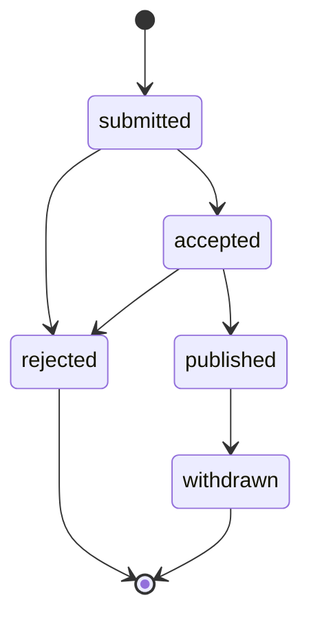

# Drafts in storage

Each contribution waits as a draft in your storage. An admin accepts,
rejects or publishes it in your app. Only the sink and the decision step
differ from pull requests.

## When to use drafts

Use drafts instead of pull requests in these conditions:

- A database or a search index holds the published copy.
- The reviewers work in an admin page of your app.
- The data must not go to GitHub.

## The states

A draft starts in `submitted`. The constant `TRANSITIONS` holds the
allowed moves. Any other move raises `TransitionError`.



Each decision adds a `Decision` to the history of the draft: the new
state, the reviewer, the UTC time, and a comment. A rejection must have
a comment.

## The pieces

| Piece              | Task                                                        |
| ------------------ | ----------------------------------------------------------- |
| `FolderDraftStore` | Writes `<root>/<id>/files/` and `<root>/<id>/draft.json`    |
| `DraftSink`        | Saves each valid contribution as a draft in `submitted`     |
| `Review`           | Checks a move, calls your hooks, and records the decision   |
| `review_router`    | The admin endpoints under `/drafts`                         |

`open_count` counts the drafts in `submitted` or `accepted`. The
pipeline compares this number with `max_open`.

## Wire it

This project has its own contributor model and an upload e-mail.

```python
from pathlib import Path

from fastapi import Header, HTTPException
from pydantic import BaseModel

from enacit4r_contrib import Pipeline, contribution_router
from enacit4r_contrib.drafts import (
    DraftSink,
    FolderDraftStore,
    Review,
    review_router,
    secret_id,
)


class Person(BaseModel):
    name: str
    email: str
    institution: str | None = None
    method: str


async def mail_admins(draft):
    await send_mail("New contribution", draft.id)  # your mailer


store = FolderDraftStore(Path("/data/drafts"), contributor=Person)
sink = DraftSink(store, make_id=secret_id, on_submit=mail_admins)
pipeline = Pipeline(validate, sink)


def reviewer(x_user: str | None = Header(default=None)) -> str:
    # Placeholder: replace with your own auth (Keycloak, GitHub OAuth, a password).
    if x_user is None:
        raise HTTPException(401, "Log in")
    return x_user


async def on_publish(draft, files):
    await load_into_database(draft.id, files)  # your project's loader


app.include_router(
    contribution_router(
        pipeline, allow=["*.csv"], contributor=Person, public_state=sink.state
    )
)
app.include_router(
    review_router(Review(store, on_publish=on_publish), reviewer=reviewer),
    prefix="/admin",
)
```

The `reviewer` dependency returns the name of the reviewer, or raises
401 or 403.

| Endpoint                            | Result                              |
| ----------------------------------- | ----------------------------------- |
| `GET /drafts?state=`                | The drafts, filtered by state       |
| `GET /drafts/{id}`                  | One draft                           |
| `GET /drafts/{id}/files/{path}`     | The bytes of one file               |
| `POST /drafts/{id}/decision`        | Body `{state, comment}`, a decision |

A decision answers 200 with the draft. A move that `TRANSITIONS` does
not allow answers 409. A rejection without a comment answers 422. An
unknown draft or file answers 404.

## Publication

To publish, the admin moves an accepted draft to `published`. `Review`
calls `on_publish(draft, files)` first. If the hook fails, the router
answers 502 and the draft stays `accepted`.

After each saved decision, `Review` calls `on_change(draft, decision)`.
Use it to send an e-mail. If `on_change` fails,
the decision stays saved and the library logs the error.

To take published data back, the admin moves the draft to `withdrawn`,
with a comment. `Review` calls `on_withdraw(draft)` first. If it fails,
the draft stays `published`. Read [Withdraw data](withdraw.md).

## Fit your project

- Contributor model: give the same model to the store and to the
  router. The router reads the fields of the model. `GitHubPRSink`
  needs the fields of `Contributor`.
- JSON contributor: a form field `contributor` can hold a JSON object.
  Then the router ignores the other contributor fields.
- Upload e-mail: `on_submit` runs after the save. If it fails, the
  library logs the error.
- Public state: `public_state=sink.state` adds
  `GET /contributions/{id}/state`. It returns only the state. Use
  `make_id=secret_id`: then only the contributor knows the ID.
- Case: with `ignore_case=True`, `*.ply` matches `X.PLY`.
- Prefix: mount `contribution_router` without a prefix, else the route
  becomes `/contributions/contributions`.
- Unknown files: the router refuses an upload with a file that `allow`
  does not match. Show the issue list in the form.

## Store drafts in S3

To use S3 or a database, write a class with the four methods of
`DraftStore`, as `FolderDraftStore` does. To read a draft, call
`Draft.from_dict(data, contributor)` with your contributor model.
`load` must raise `KeyError` for a missing draft. Refuse an ID that is
not a single safe path segment.

## The three projects

hobel-iaqdb keeps its drafts in S3 and loads Postgres at publication.
ALICE-ETHZ-AREMA keeps them in its Postgres rows, with Keycloak roles
as reviewer. It has more states, so it can use only the sink.
eesd-mmsdb uses `FolderDraftStore` and a manual git step.

## Next step

Read [Testing](testing.md) to test your routes. For the pull request
pattern, read [Sinks](sinks.md).
To move your own upload code to the library, read [Adopt the draft pattern](adopt.md).
