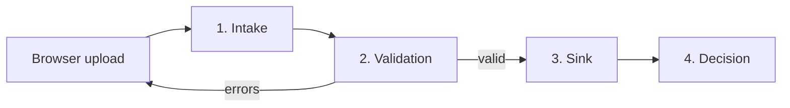

# enacit4r-contrib

enacit4r-contrib is a Python library that takes data contributions in
EPFL ENAC IT4R projects. A contributor uploads files in the browser.
The library checks the files with the rules of your project and sends
them to a person for review. If your project accepts data from people
outside the team, use this library. It gives you safe file intake, one problem
format, and a review request, so that you write only your rules.

## The four steps

Each contribution goes through four steps. The library does the first
three. Your project does the fourth.

1. Intake: `read_upload` reads loose files, a `.zip`, or a `.tar.gz`.
   It refuses unsafe paths and uploads that are too large. It reports
   the files that your template does not expect.
2. Validation: your project gives a validator. A validator is a
   function that returns a list of problems. The library calls each
   problem an `Issue`.
3. Sink: a sink stores a valid contribution for review. The library
   gives `GitHubPRSink`, which opens a GitHub pull request, and
   `DraftSink`, which saves a draft in storage.
4. Decision: a person reviews the contribution and accepts or refuses
   it. For drafts, `Review` and `review_router` record the decision.

## The two patterns

Five IT4R projects take contributions. They use one of two patterns.
The difference is only the sink.

| Pattern            | Sink                                  | Decision                    |
| ------------------ | ------------------------------------- | --------------------------- |
| Pull request       | `GitHubPRSink`: a branch and a PR     | A GitHub review and a merge |
| Draft in storage   | `DraftSink`: a folder, S3, a database | An admin action: `Review`   |

The two patterns are ready to use. [Drafts in storage](drafts.md)
tells you how to wire the draft pattern.

## The pages of this site

- [Getting started](getting-started.md): install the library and add
  the two endpoints to a FastAPI backend.
- [Validators](validators.md): write the rules of your project.
- [HTTP API](http-api.md): the endpoints, the status codes, and a
  browser client.
- [GitHub App](github-app.md): create the App that opens the pull
  requests.
- [Sinks](sinks.md): what `GitHubPRSink` writes, and how to write a
  different sink.
- [Drafts in storage](drafts.md): drafts, an admin review, and publication.
- [Ingest](ingest.md): fold a merged contribution into your data.
- [Withdraw data](withdraw.md): take accepted data out of your dataset.
- [Testing](testing.md): test your integration without GitHub.
- [Contribution pipelines in five projects](research/contribution-pipelines.md):
  the study that gave the design.

## Next step

Read [Getting started](getting-started.md) and add the library to your
backend.
