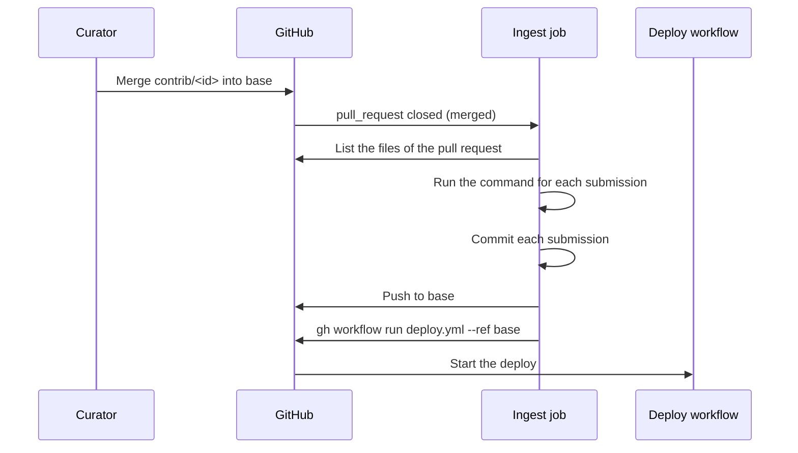

# Ingest a merged contribution

After a curator merges a contribution, the submission is a folder
`submissions/<id>/` on the base branch. The `ingest` action runs your
command to fold it into your dataset, then does the git steps.

## What the action does

The action runs on the base branch after a curator merges a pull
request from a `contrib/<id>` branch.

1. It lists the files of the pull request and keeps each
   `<folder>/<id>` that is in the working tree.
2. For each submission, it runs your command with
   `SUBMISSION=<folder>/<id>`, from the repository root.
3. It makes one commit per submission:
   `chore(data): ingest <folder>/<id> (#<pr>)` (input `commit-prefix`). If the command changes nothing,
   the action makes no commit.
4. It pushes to the base branch. If the base branch moved, the push is
   refused. Then the action fetches the base branch and does all the
   steps again. After 3 refused pushes, the action fails.
5. If you set `deploy-workflow`, it starts that workflow on the base
   branch.

A push with the `GITHUB_TOKEN` starts no workflow. Thus the action
starts your deploy workflow itself.



## Add the workflow

Your workflow must check out the base branch with `fetch-depth: 0` and
set up your tools before the action. The action does not do these
steps.

```yaml
name: Ingest

on:
  pull_request:
    types: [closed]

permissions:
  contents: write
  actions: write
  pull-requests: read

concurrency:
  group: ingest-${{ github.event.pull_request.base.ref }}
  cancel-in-progress: false

jobs:
  ingest:
    if: github.event.pull_request.merged && startsWith(github.head_ref, 'contrib/')
    runs-on: ubuntu-latest
    steps:
      - uses: actions/checkout@v4
        with:
          ref: ${{ github.event.pull_request.base.ref }}
          fetch-depth: 0
      - uses: astral-sh/setup-uv@v6
      - uses: EPFL-ENAC/enacit4r-contrib/ingest@0.6.1
        with:
          pr-number: ${{ github.event.pull_request.number }}
          base: ${{ github.event.pull_request.base.ref }}
          command: uv run python scripts/ingest.py "$SUBMISSION"
          deploy-workflow: deploy.yml
```

The `concurrency` group runs one ingest at a time for each branch.
The other inputs have these default values:

| Input            | Default                                                 |
| ---------------- | ------------------------------------------------------- |
| `folder`         | `submissions`                                           |
| `token`          | `${{ github.token }}`                                   |
| `deploy-workflow` | Empty: the action starts no workflow                   |
| `commit-prefix`  | `chore(data)`                                           |
| `git-user-name`  | `enacit4r-contrib`                                      |
| `git-user-email` | `41898282+github-actions[bot]@users.noreply.github.com` |

The `folder` input must be the same as the `folder` of `GitHubPRSink`.
The push uses the credentials of `actions/checkout`. If you use a
different `token`, give the same token to `actions/checkout`.

## What the command must do

The action runs the command once for each submission. The command must:

- Fold the files in `$SUBMISSION` into your data, for example add the
  rows to a table.
- Delete the folder `$SUBMISSION`, so that the next ingest does not see
  it again.
- Fail with a clear message and a non-zero exit code if the data is
  not correct. Do not skip a bad file.

The action commits all the changes in the working tree. Do not leave
temporary files.

## Write the command with the helpers

The module `enacit4r_contrib.ingest` does the file operations. Your
command keeps only the rules of your data.

- A `Plan` checks all the changes before the first write. If one
  change cannot be done, it writes nothing and raises `IngestError`.
- `Plan.append` does not change the old bytes of a CSV.
- `run` prints the errors of an `IngestError` and returns exit code 1.

This example adds the rows of `table.csv` to `data/table.csv`. It copies each curve
`curves/<name>.csv` to `data/curves/<id>.csv`.

```python
import csv
import io
import sys
from pathlib import Path

from enacit4r_contrib.ingest import IngestError, Plan, next_number, read_folder, run

DATA = Path("data")


def ingest(submission: Path) -> list[str]:
    files = read_folder(submission)
    table = DATA / "table.csv"
    with table.open(encoding="utf-8-sig", newline="") as f:
        n = next_number(row["id"] for row in csv.DictReader(f))
    text = files["table.csv"].decode("utf-8-sig")
    plan, rows, done = Plan(), [], []
    for row in csv.DictReader(io.StringIO(text, newline="")):
        name = row["name"]
        curve = files.get(f"curves/{name}.csv")
        if curve is None:
            raise IngestError(f"{name}: the file curves/{name}.csv is missing")
        rows.append([str(n), name])
        plan.create(DATA / "curves" / f"{n}.csv", curve)
        done.append(f"ingested {name} as id {n}")
        n += 1
    plan.append(table, rows)
    plan.remove(submission)
    plan.apply()
    return done


if __name__ == "__main__":
    sys.exit(run(ingest))
```

## When the command fails

If the command fails, the action stops with exit code 1 and pushes
nothing. The log of the workflow run shows the output of the command
and this line:

```text
The ingest command failed for submissions/<id>. Nothing was pushed.
```

The submission stays on the base branch. Push a fix, then run the
failed job again.

## Next step

Read [Testing](testing.md) to test your integration without GitHub.
To take data out, read [Withdraw data](withdraw.md).
